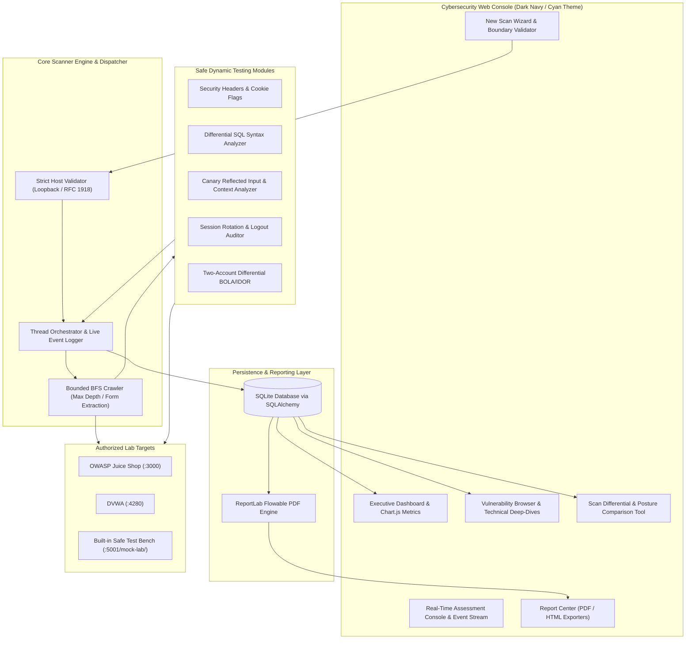

# 🛡️ WebScanPro — Web Application Security Testing Tool

[](https://python.org)
[](https://flask.palletsprojects.com/)
[](#security-boundaries)
[](#running-automated-tests)
[](#design-overview)

**WebScanPro** is a dynamic application security testing (DAST) platform engineered to crawl authorized web applications, identify high-risk vulnerabilities, capture verifiable technical evidence, calculate CVSS-aligned severities, formulate actionable developer remediations, and generate auditor-grade PDF and HTML reports.

Built with a dark navy/charcoal cybersecurity dashboard (`#090d16`, `#0f172a`, `#131d31`) accented with neon cyan (`#00e5ff`) and electric blue (`#38bdf8`), the platform delivers the UX of an enterprise security suite.

---

## 📋 Table of Contents
- [Architecture & Data Flow](#-architecture--data-flow)
- [Core Security Testing Modules](#-core-security-testing-modules)
- [Security Restrictions & Safe Heuristics](#-security-restrictions--safe-heuristics)
- [Quick Start: Mac Installation & Execution](#-quick-start-mac-installation--execution)
- [Local Security Lab Targets](#-local-security-lab-targets)
- [Running Automated Tests](#-running-automated-tests)
- [Docker Deployment](#-docker-deployment)
- [Executive Report Generation](#-executive-report-generation)
- [Project Presentation Outline](#-final-project-presentation-outline)

---

## 🏛️ Architecture & Data Flow



---

## 🔍 Core Security Testing Modules

| Module | Target Weakness | Detection Technique & Safe Heuristic | OWASP Top 10 | CWE |
| :--- | :--- | :--- | :--- | :--- |
| **Safe Crawler** | Surface Discovery | Breadth-First link and form parsing with canonical URL deduplication. Strictly bounded depth and page budgets; ignores logout endpoints. | Reconnaissance | CWE-Other |
| **Security Headers & Cookies** | Missing Defenses & Flags | Passive inspection of response headers (`CSP`, `HSTS`, `X-Content-Type-Options`, `X-Frame-Options`) and cookie attributes (`HttpOnly`, `Secure`, `SameSite`). | A05:2021 Security Misconfiguration | CWE-1021, CWE-1004, CWE-614 |
| **SQL Injection Detector** | SQL Syntax Anomalies | Non-destructive single quote `'` and double quote `"` syntax testing. Detects database engine error signatures (SQLite, MySQL, Postgres, MSSQL, Oracle) and differential recovery. Never executes destructive operations. | A03:2021 Injection | CWE-89 |
| **Reflected Input / XSS** | Missing Output Encoding | Injects harmless alphanumeric canary markers (e.g. `wsp<hex><wsptag>`) and inspects raw DOM, attribute, and script contexts. Never executes harmful JavaScript payloads. | A03:2021 Injection | CWE-79 |
| **Authentication & Sessions** | Insecure Transport & Session Handling | Evaluates cleartext HTTP transport of credentials, session token entropy/predictability, and verifies server-side invalidation upon logout using designated test accounts. | A07:2021 Identification & Auth Failures | CWE-319, CWE-384, CWE-613 |
| **Access Control & IDOR** | Broken Object Authorization | Controlled two-account differential analysis: compares Test Account A accessing its own resource against Test Account B attempting to access Account A's resource. Audits unauthenticated object endpoints. | A01:2021 Broken Access Control | CWE-639, CWE-284 |

---

## 🔒 Security Restrictions & Safe Heuristics

To ensure ethical, safe, and controlled operation:
1. **Loopback & Lab Allowlisting**: By default, scans are restricted strictly to `localhost`, `127.0.0.1`, `::1`, and private Docker subnets. Arbitrary public domain scans are blocked.
2. **Explicit Operator Authorization**: Every scan requires the operator to verify authorization via an explicit confirmation checkbox.
3. **Polite Crawling & Budgets**: Crawlers enforce max depth (default 3), max page limits (default 30), request delays (default 50ms), and timeout limits (5s) to prevent denial of service.
4. **Non-Destructive Testing**: All test probes are diagnostic and non-destructive. No SQL `DROP`, `UPDATE`, `DELETE`, or `UNION` data exfiltration queries are ever sent.
5. **No Harmful Payloads**: XSS testing utilizes benign HTML canary tags without `<script>`, `onerror`, or execution hooks.
6. **Data Privacy**: Passwords, sensitive session tokens, and personal credentials are never logged or stored in reports.

---

## 🚀 Quick Start: Mac Installation & Execution

### Prerequisites
- macOS (Apple Silicon or Intel)
- Python 3.11 or higher (Python 3.14 fully supported)

### Step 1: Open Terminal and Navigate to Project
```bash
cd "/Users/tusharkalyani/On Mac/WebScanPro"
```

### Step 2: Set Up Virtual Environment & Dependencies
```bash
# Create Python virtual environment
python3 -m venv venv

# Activate virtual environment
source venv/bin/activate

# Install required packages
pip install -r requirements.txt
```

### Step 3: Launch WebScanPro with Seeded Demo Data
```bash
# Seed realistic demo data and launch the web server
python run.py --seed-demo
```

### Step 4: Access the Web Console
Open your web browser and navigate to:
- **Security Dashboard**: [http://127.0.0.1:5001](http://127.0.0.1:5001)
- **Built-in Mock Vulnerable Lab**: [http://127.0.0.1:5001/mock-lab/](http://127.0.0.1:5001/mock-lab/)

*(Note: Port 5001 is used by default on macOS to avoid port 5000 conflicts with Apple AirPlay Receiver.)*

---

## 🧪 Local Security Lab Targets

WebScanPro supports multiple local lab targets out of the box:

### 1. Built-in Mock Target Lab (Zero Dependencies)
A dedicated vulnerable test bench is built into WebScanPro! You do not need to install Docker to verify the scanner:
- Accessible at: `http://127.0.0.1:5001/mock-lab/`
- Includes simulated endpoints for SQL error detection, reflected XSS, missing headers, cookie security, and IDOR testing.

### 2. OWASP Juice Shop (Port 3000)
Run the industry-standard training lab locally with Docker:
```bash
docker run -d --name juice-shop -p 3000:3000 bkimminich/juice-shop
```
In WebScanPro, select the **OWASP Juice Shop** preset (`http://localhost:3000`) on the New Scan page!

### 3. Damn Vulnerable Web App (DVWA - Port 4280)
```bash
docker run -d --name dvwa -p 4280:80 vulnerables/web-dvwa
```
Navigate to `http://localhost:4280/setup.php` to initialize the database (default login: `admin / password`).

---

## 🧪 Running Automated Tests

WebScanPro includes a comprehensive unit and integration test suite covering URL validation, safe crawling, security modules, database persistence, and reporting.

Execute all 51 automated tests (unit, integration, system audit, and live lab scenarios):
```bash
# Ensure virtual environment is activated
source venv/bin/activate

# Run pytest with PYTHONPATH
PYTHONPATH=. pytest tests/ -v
```

Expected output:
```
============================== 51 passed in 1.27s ==============================
```

To run individual test modules:
```bash
PYTHONPATH=. pytest tests/test_security_modules.py -v
PYTHONPATH=. pytest tests/test_lab_scenarios.py -v
PYTHONPATH=. pytest tests/test_target_validator.py -v
PYTHONPATH=. pytest tests/test_crawler.py -v
PYTHONPATH=. pytest tests/test_routes.py -v
PYTHONPATH=. pytest tests/test_reports.py -v
```

---

## 🐳 Docker Deployment

To run WebScanPro and OWASP Juice Shop together using Docker Compose:

```bash
# Build and run containers in detached mode
docker compose up -d

# Check running status
docker compose ps
```

- WebScanPro: [http://localhost:5001](http://localhost:5001)
- OWASP Juice Shop: [http://localhost:3000](http://localhost:3000)

To shut down:
```bash
docker compose down
```

---

## 📊 Executive Report Generation

Every completed scan automatically produces two auditor-grade deliverables:
1. **Executive PDF Report**: Built with ReportLab, featuring:
   - Executive metadata and scope summary
   - Color-coded severity breakdown table
   - Categorized technical findings with CVSS scores
   - Recorded evidence boxes
   - Step-by-step developer remediation
   - Safe manual verification protocol
   - Assessment limitations disclaimer
2. **Interactive HTML Report**: Print-optimized standalone report accessible directly from the browser (`/reports/scan/<id>/html`).

---
